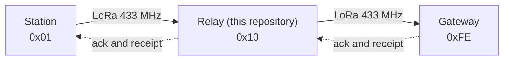

<div align="center">

# TerraWatch relay firmware

**The hop in the middle.** A radio with no sensors that carries station packets toward the gateway, so a station deep in the forest does not need to reach the gateway itself.

[**Hardware test guide**](TESTING.md) &nbsp;·&nbsp; [Station firmware](https://github.com/Terra-Watch/node-firmware) &nbsp;·&nbsp; [Gateway firmware](https://github.com/Terra-Watch/gateway-firmware) &nbsp;·&nbsp; [Network simulation](https://github.com/Terra-Watch/node-firmware/tree/main/simulations/multihop)


</div>



---

## How it is built

This repository holds one file of its own, `src/main.cpp`. The libraries, the configuration and `App.cpp` come from [node-firmware](https://github.com/Terra-Watch/node-firmware), which must be cloned next to this one:

```
your-folder/
├── node-firmware/      # protocol, routing, forwarding, radio driver
└── relay-firmware/     # this repository
```

A protocol or routing fix in the station firmware therefore reaches the relay with the next build.

| | |
|---|---|
| **Radio** | SX1278 at 433 MHz, protocol v5 (12-byte header, next hop in the header, CRC-16) |
| **Node ID** | `TW_NODE_ID` in `platformio.ini`; 16 (`0x10`) by default |
| **Route to the gateway** | The gateway sends no route advertisements, so the relay keeps a direct route to `0xFE` alive itself: refreshed every 20 s, with a route lifetime of 60 s |
| **Console** | 921600 baud. At 115200 the logging corrupts radio reception on this board |

## Build

```bash
git clone https://github.com/Terra-Watch/node-firmware
git clone https://github.com/Terra-Watch/relay-firmware
cd relay-firmware
pio run                  # relay_esp32: NodeMCU-32S (classic ESP32), the default
pio run -e relay         # an ESP32-S3 devkit instead
pio run -t upload --upload-port <your port>
pio device monitor -b 921600
```

| Environment | Board | Use |
|---|---|---|
| `relay_esp32` | NodeMCU-32S | The default relay |
| `relay` | ESP32-S3 devkit | The same relay on an S3 |
| `relay_esp32_diag` | NodeMCU-32S | Adds a channel-energy report every 2 s, to find out whether the radio hears the gateway at all |
| `relay_esp32_test` | NodeMCU-32S | Adds the serial test command `SEND_DATA <node id> <text>` to push a packet through the link |

## Wiring (NodeMCU-32S)

The SX1278 module is **3.3 V only**. Fit the 433 MHz antenna before transmitting.

| SX1278 | NodeMCU-32S pin |
|---|---|
| VCC | 3V3 |
| GND | GND |
| SCK | P18 |
| MISO | P19 |
| MOSI | P23 |
| NSS (CS) | P5 |
| RST | P14 |
| DIO0 | P26 |

P18, P19, P23 and P5 are the board's default VSPI pins. Keep the radio off P0, P2, P12 and P15 (boot-strapping pins) and off P6 to P11 (the flash). The classic ESP32 has no built-in USB, so flashing and the console go through the board's USB-serial chip.

## Test it on real boards

[`TESTING.md`](TESTING.md) walks through it with three boards: gateway alone, station to gateway, relay in the middle, a message sent by hand, and the relay unplugged mid-run.

## Status

| | |
|---|---|
| Builds | Yes |
| Flashed | No |
| Over the air | Not tested |
| Open question | The return path. For the gateway's acknowledgement to reach the station through the relay, the relay must know a route to the station. Not checked |

If you have the boards and try it, please send back what you see, including failures.

---

<sub>Part of <a href="https://github.com/Terra-Watch">TerraWatch</a>: <a href="https://github.com/Terra-Watch/node-firmware">station</a> · <a href="https://github.com/Terra-Watch/gateway-firmware">gateway</a> · <a href="https://github.com/Terra-Watch/acoustic-ml">sound classifier</a> · <a href="https://github.com/Terra-Watch/dashboard">dashboard</a></sub>
